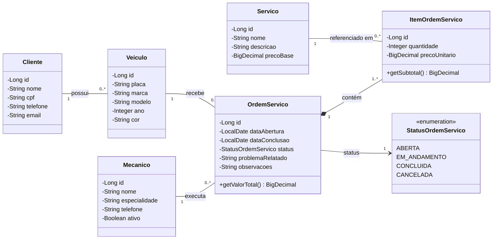
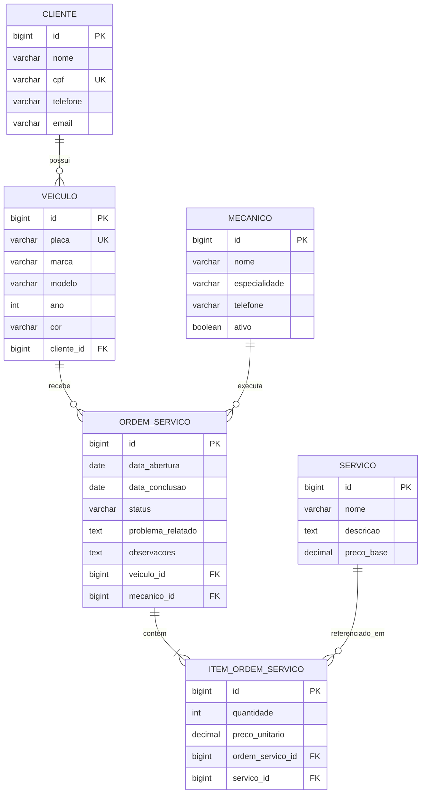

# MecaGestão

Sistema web para gestão de uma oficina mecânica. Ele centraliza o cadastro de clientes, veículos, mecânicos e serviços, e controla as ordens de serviço, do recebimento do veículo até a conclusão do trabalho.

Projeto da disciplina, desenvolvido com Spring Framework. Este documento corresponde à **1ª etapa**: tema, protótipos de tela, diagrama de classes e MER.

## Funcionalidades

| Módulo | Operações | Descrição |
| --- | --- | --- |
| Clientes | Cadastro, edição, exclusão e listagem | Donos dos veículos atendidos |
| Veículos | Cadastro, edição, exclusão e listagem | Cada veículo pertence a um cliente |
| Mecânicos | Cadastro, edição, exclusão e listagem | Profissionais responsáveis pelas ordens |
| Serviços | Cadastro, edição, exclusão e listagem | Catálogo de serviços com preço base |
| Ordens de serviço | Cadastro, edição, exclusão, listagem e detalhe | Atendimento de um veículo, com um ou mais serviços |

## Arquitetura e tecnologias

O sistema usa a arquitetura MVC, com Spring MVC, Thymeleaf, Spring Data JPA e banco de dados relacional MySQL.

| Camada | Componentes |
| --- | --- |
| Model | Entity, Repository e Service |
| Control | Controllers |
| View | Telas HTML/CSS/JS com Thymeleaf |

Os Controllers acessam apenas os Services. Somente os Services acessam os Repositories.

## Diagrama de classes

## MER

O campo `preco_unitario` guarda o preço cobrado na ordem. Assim, alterar o preço base de um serviço não muda os valores de ordens já registradas.

O valor total da ordem não é armazenado. Ele é calculado pela soma de `quantidade × preco_unitario` dos itens.

## Protótipos de tela

**[Ver os protótipos de tela](prototipos/README.md)**

Há também uma versão navegável em HTML/CSS/JS. Para usá-la, baixe o repositório e abra o arquivo `prototipos/index.html` no navegador.
