# Protótipos de tela

[Voltar ao README principal](../README.md)

Os dados exibidos são fictícios. Para navegar entre as telas, baixe o repositório e abra `index.html` no navegador.

## Painel

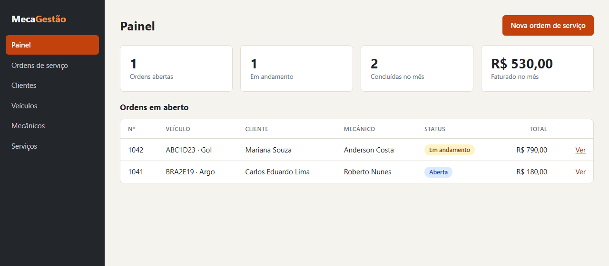

## Ordens de serviço

### Listagem

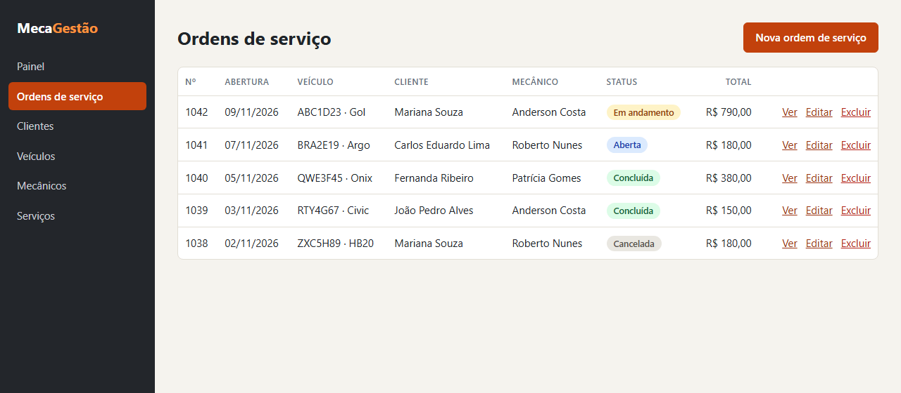

### Cadastro

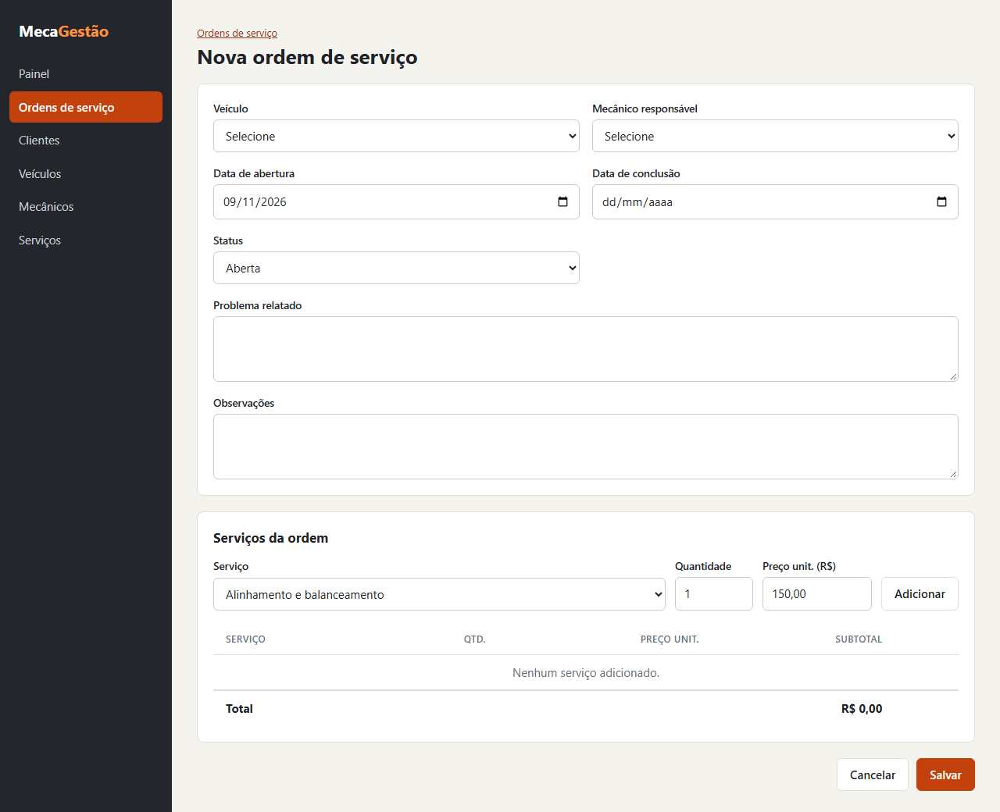

### Edição

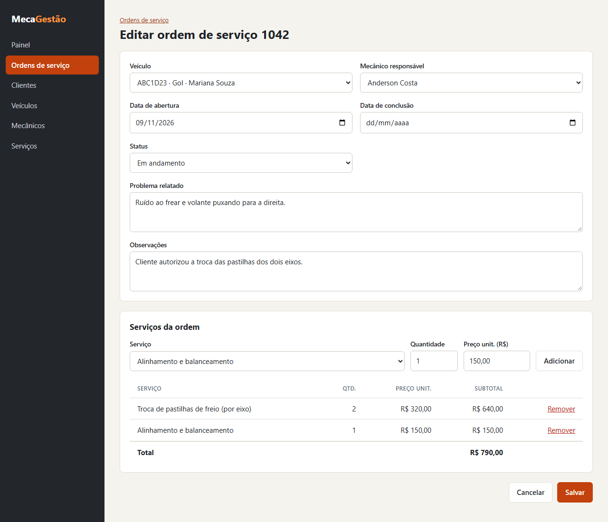

### Detalhe

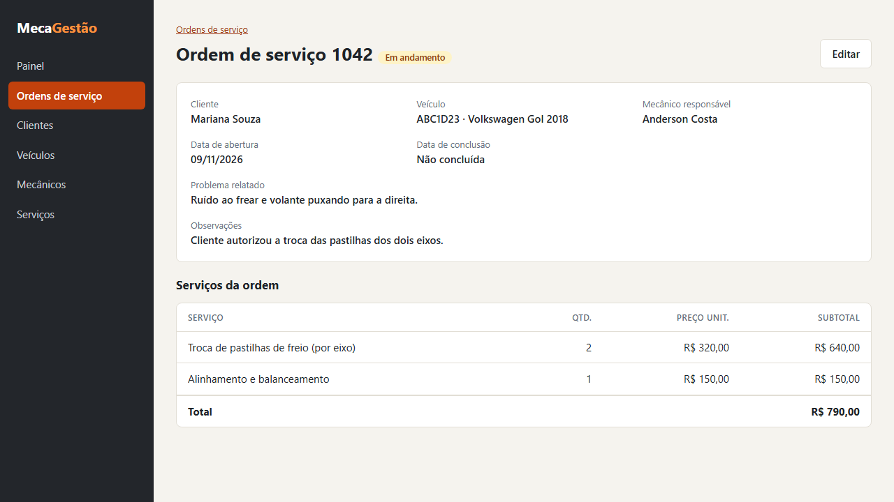

### Exclusão

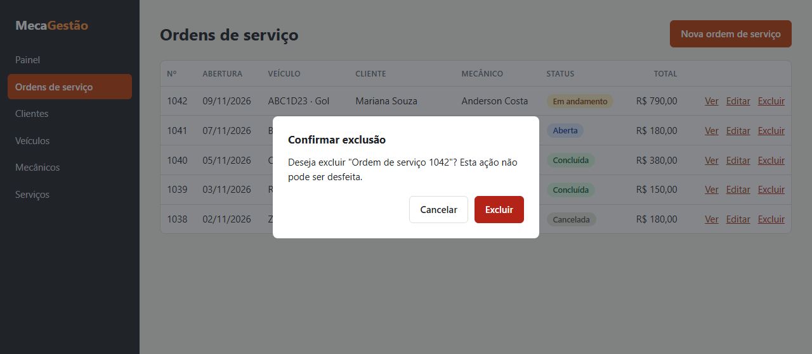

## Clientes

### Listagem

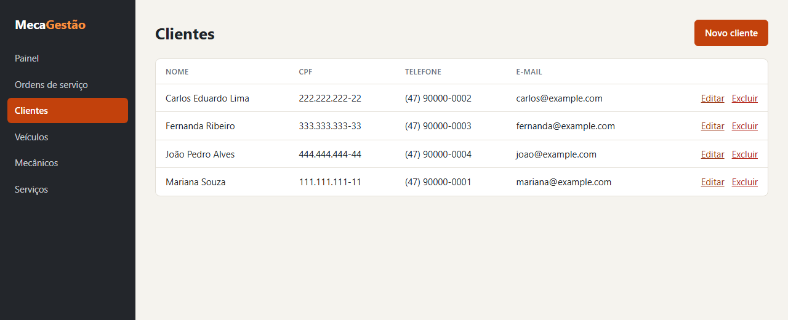

### Cadastro

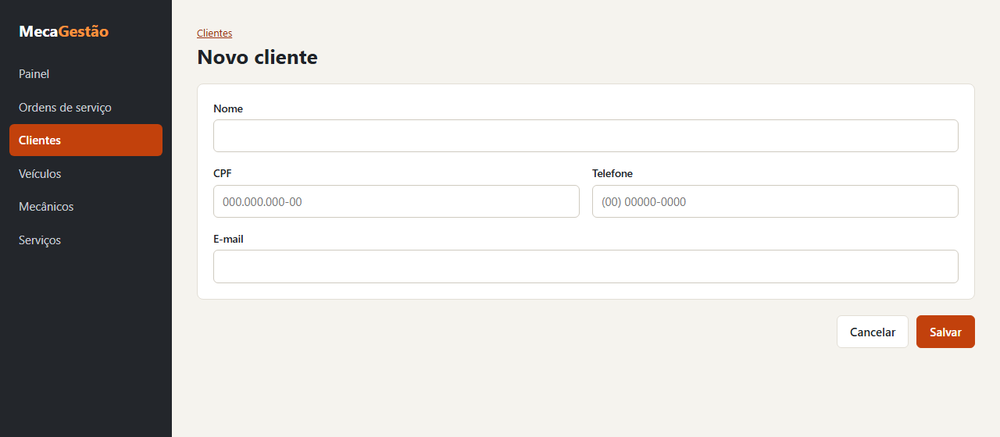

### Edição

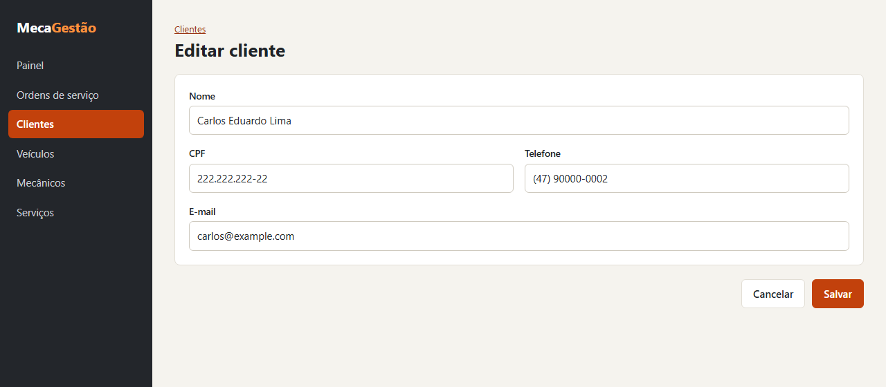

### Exclusão

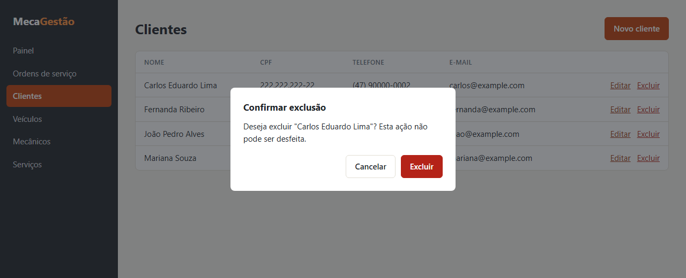

## Veículos

### Listagem

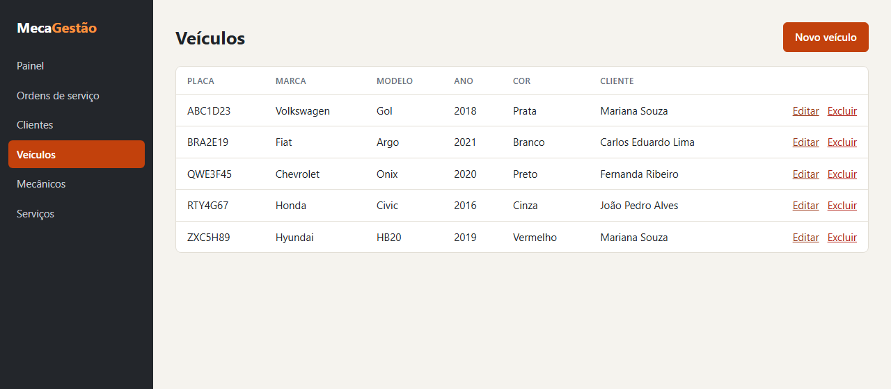

### Cadastro

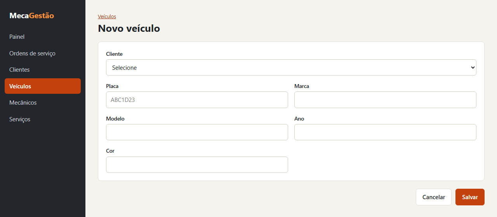

### Edição

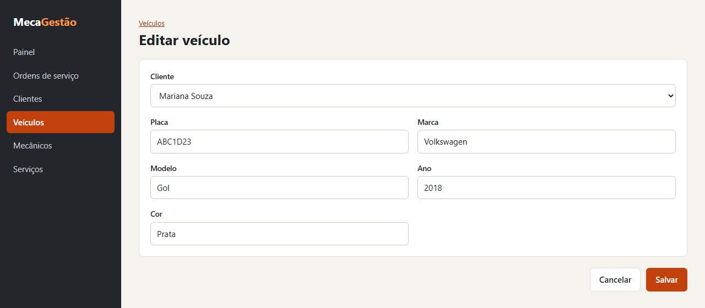

### Exclusão

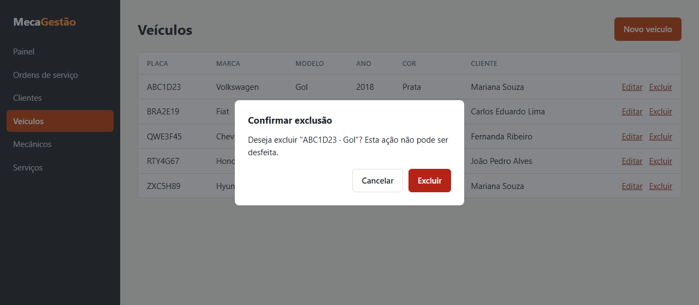

## Mecânicos

### Listagem

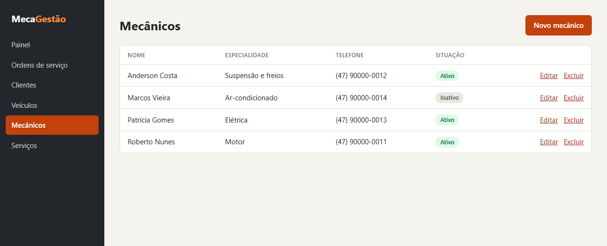

### Cadastro

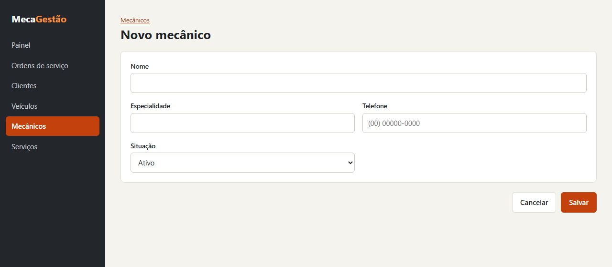

### Edição

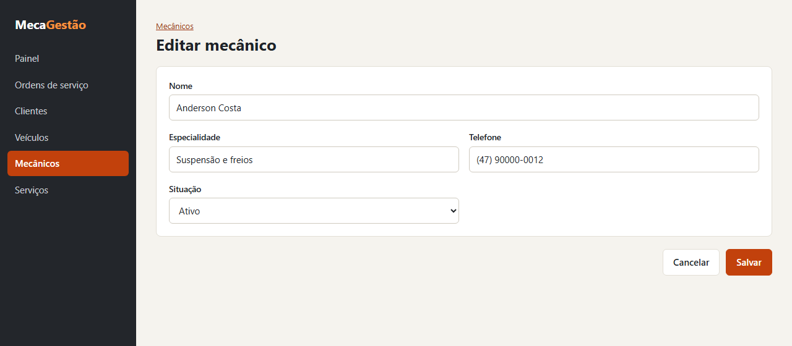

### Exclusão

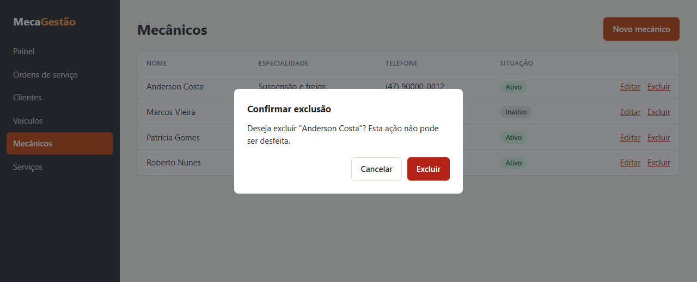

## Serviços

### Listagem

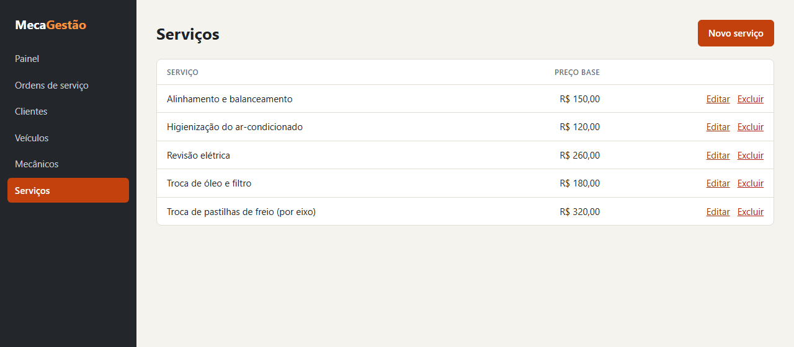

### Cadastro

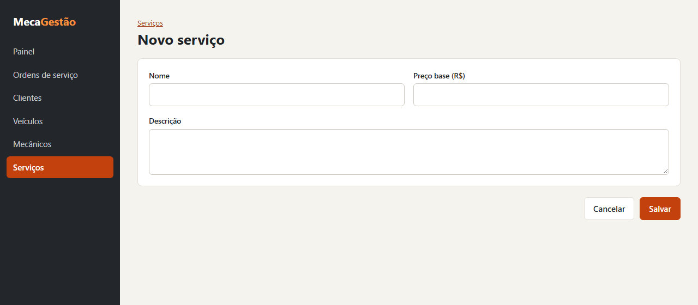

### Edição

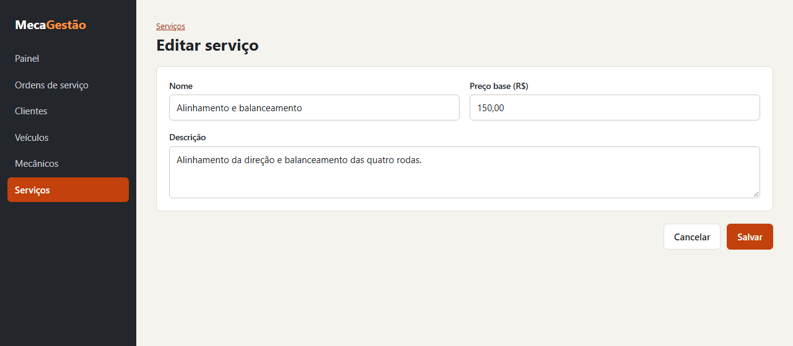

### Exclusão

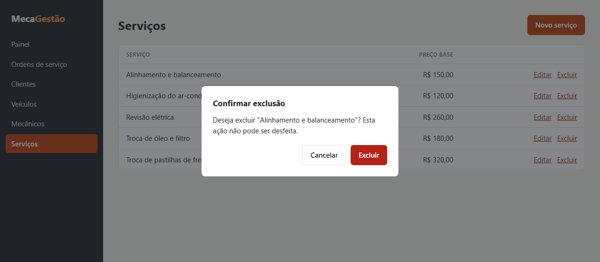
